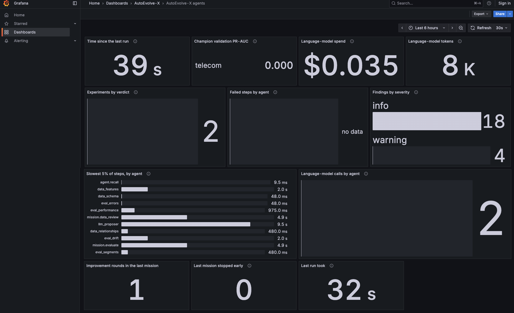
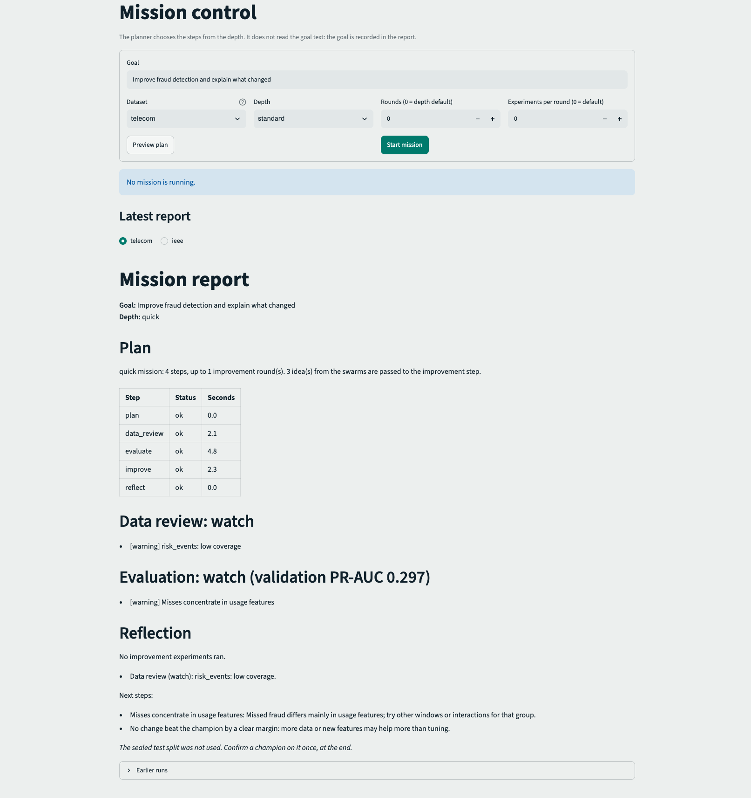
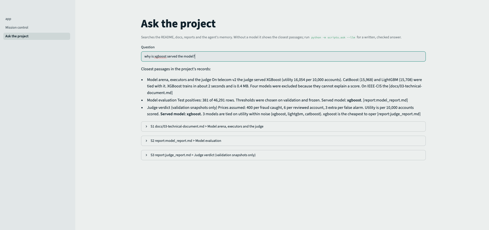

# AutoEvolve-X

[](https://github.com/Asm2910/autoevolve-x/actions/workflows/ci.yml)

A fraud-risk system in which **a language model proposes and plain code decides**. A mission planner sends a team of small agents to review the data, evaluate the model, compare eight algorithms, test improvements and write down what it learned. Every claim is checked by a statistical rule, a sealed test set or a citation check, and the whole thing is reproducible, served through an API and monitored with Prometheus and Grafana.

> The test set is sealed. Agents read only train and validation data, and models are chosen on validation.


See [docs/ARCHITECTURE.md](docs/ARCHITECTURE.md) for the mission graph, the agent harness and the monitoring flow.

## Results

Two datasets, kept apart. **Telecom** is synthetic data with a hidden ground truth, so its scores say the method works, not how it would do on real subscribers. **IEEE-CIS** is a real e-commerce fraud dataset from Kaggle, used as validation on real data. It is not telecom data and was not combined with it.

| Dataset | Test rows (positives) | Served model | Test PR-AUC [95% CI] | ROC-AUC | Logistic regression PR-AUC |
| --- | --- | --- | --- | --- | --- |
| Telecom v2 (synthetic) | 46,291 (381) | xgboost | 0.292 [0.243, 0.356] | 0.787 | 0.213 [0.173, 0.265] |
| IEEE-CIS (real, 300k sample, split by time) | 60,000 (2,060) | lightgbm | 0.448 [0.425, 0.472] | 0.873 | 0.185 [0.173, 0.200] |

- **The judge picks by cost, not by the top number.** On telecom the best three boosted models are tied within noise, and random forest and extra trees (0.300) are statistically tied with xgboost on the test set. The judge scores models by business utility, excludes models that cannot explain a score, and among tied models serves the cheapest to run.
- **The agent adopts changes only with evidence.** On telecom it tried window changes and rejected them all, because every interval included zero or was below it. On IEEE it adopted deeper trees (+0.018 validation PR-AUC at depth 4, interval above zero). Rejecting is a valid outcome.
- **The evaluation swarm found a real weakness on IEEE.** Fraud among payments with no identity record is caught at about 6.5%, against 37.8% overall.
- **Ray gave no speed-up here.** Training 7 models on a 10-core Mac took 104.6 s sequentially, 112.2 s with 2 Ray workers (0.93x) and 132.7 s with 4 (0.79x). The models are small, so process start-up and data transfer cost more than they save. Ray is kept for isolation, timeouts, retries and a path to a cluster, not for speed at this size.

Older results from dataset v1 (seed 42, PR-AUC 0.272) are in [docs/v1_results](docs/v1_results).

## What it does

- **Mission planner.** Rule-based, with three depths (quick, standard, thorough). It re-plans after the data review and the evaluation. It does not read the goal text.
- **Data swarm.** Schema, quality, relationship and feature agents. Feature screening uses Benjamini-Hochberg false discovery control, an effect-size floor and a leakage check.
- **Evaluation swarm.** Performance, segment, error and drift agents. Segment findings use Bonferroni-corrected bootstrap and merge groups that cover identical accounts.
- **Model arena and judge.** Eight algorithms behind one registry, run sequentially or on Ray. The judge uses utility per 10,000 accounts, a paired bootstrap and an explainability rule.
- **Improvement agent.** A LangGraph loop that proposes one experiment (Claude, or a rule-based fallback), checks it is new, runs it, and adopts it only if the paired bootstrap lower bound is above zero and the gain is at least 0.01 PR-AUC.
- **Reflection and memory.** Grounded lessons are written to memory (SQLite, FTS5 keyword search, ChromaDB vectors, merged by reciprocal rank fusion) and recalled by later missions.
- **Research agent.** Answers questions from the project's own README, docs, reports and memory, with sources. With a model, citations and numbers are checked in code.
- **Guardrails and harness.** Budgets, a kill switch, contracts with timeouts and retries, untrusted-text handling, JSONL traces and Prometheus agent metrics.
- **Control panel.** A Streamlit dashboard with the review page, mission control (start, watch, stop) and an ask page.
- **Serving and monitoring.** A FastAPI service with request IDs, JSON logs and explanations; Prometheus, a Pushgateway, MLflow and two provisioned Grafana dashboards (API and agents); drift checks with PSI and KS.
- **CI.** GitHub Actions runs ruff, pytest, a quick mission and a research question on freshly built data, and a Docker build with a health check.

## Quick start

Needs Python 3.12 and, for the live stack, Docker.

```bash
python -m venv .venv && source .venv/bin/activate
pip install -r requirements-dev.txt

# 1. build the data and train the models (takes a few minutes)
python -m scripts.run_pipeline          # generate, validate, features, split, train

# 2. check everything
python -m ruff check .
python -m pytest -q

# 3. compare 8 algorithms on the validation snapshots; the judge picks the served model; explain and ablate (optional)
python -m scripts.run_arena             # logistic regression, forests, 4 boosters, isolation forest
python -m scripts.run_arena --workers 4   # same comparison, four models at a time on Ray (pip install ray)
python -m scripts.benchmark_ray           # speed-up of 1, 2 and 4 workers
python -m scripts.run_ablation
python -m scripts.explain_model

# 4. fill the memory and run the agent
python -m scripts.memory_cli ingest
python -m scripts.run_mission --depth quick                 # plan, review, evaluate, improve, reflect in one graph
python -m scripts.ask "Why is xgboost the served model?"    # answers from the docs, reports and memory, with sources
python -m scripts.run_data_review                           # four data agents check the sources and features
python -m scripts.run_evaluation                            # four evaluation agents report on the model
python -m scripts.run_agent --iterations 4                  # rule-based, no API key needed
python -m scripts.run_agent --iterations 4 --use-findings   # the proposer also reads the evaluation findings
python -m scripts.run_agent --iterations 4 --proposer llm   # Claude proposes, needs ANTHROPIC_API_KEY
touch memory/STOP                                           # from another terminal: stop a running agent

# 4b. the same system on real fraud data (IEEE-CIS from Kaggle)
python -m scripts.prepare_ieee --source ~/Downloads/ieee-fraud-detection.zip
AUTOEVOLVE_DATASET=ieee python -m scripts.run_arena --workers 1
AUTOEVOLVE_DATASET=ieee python -m scripts.run_evaluation

# 5. the evidence
python -m scripts.confirm_champion       # sealed test, runs once per dataset
python -m scripts.monitor_drift
python -m scripts.monitor_drift --simulate usage:1.6

# 6. look at it
python -m streamlit run dashboard/app.py
```

The live service, with Prometheus and Grafana:

```bash
docker compose up -d --build
python -m scripts.generate_traffic --count 300 --rate 10
python -m scripts.generate_traffic --count 300 --rate 10 --shift usage:1.6   # rehearse drift
```

| Service | Address |
| --- | --- |
| API and interactive docs | http://localhost:8000 and http://localhost:8000/docs |
| Prometheus (targets, alerts) | http://localhost:9090 |
| Grafana (API and agents dashboards) | http://localhost:3000 |
| Pushgateway (agent metrics) | http://localhost:9091 |
| MLflow | http://localhost:5001 |

Use `python -m streamlit`, not a bare `streamlit`, so the virtual environment is used. Trained models must exist in `models/artifacts/` before the Docker build.

To send agent metrics to the dashboard, run `export PUSHGATEWAY_URL=http://localhost:9091` before a mission. After switching git branches or unzipping over the repository, run `docker compose up -d --force-recreate`, because Docker keeps pointing at the folders as they were when a container started.

## Dashboard


*Example output from a local run. Your numbers will differ slightly, because each run generates its own data.*







<!-- Add once saved:  -->

## Repository layout

```
configs/               data and model settings
data_generation/       hidden world, behaviour profiles, event generators, snapshots, validation
feature_engineering/   windowed feature builder and its validation
models/                training, evaluation, explanations, MLflow tracking, artifacts
agentkit/              harness, budget, guardrails, tracing, context builder
agents/                LangGraph improvement loop, proposers, decision rule
swarm/                 data swarm and evaluation swarm
arena/ judge/          eight algorithms, executors (sequential, Ray), utility judge
mission/               planner, mission graph, reflection, report
research/              local retrieval and the grounded research agent
data_adapters/         IEEE-CIS adapter (real e-commerce fraud)
memory/                SQLite store, ChromaDB index, embedders
tools/                 experiment runner, final evaluation
monitoring/            drift checks (PSI, KS)
observability/         JSON logging, Prometheus metrics, Pushgateway push, alerts, Grafana provisioning
dashboard/             Streamlit review page, mission control, ask page
api/                   FastAPI service
scripts/               runnable steps: pipeline, agent, drift, traffic, memory CLI
tests/                 unit and API tests
docs/                  overview, design, technical, data dictionary, end-to-end guide
.github/workflows/     CI
```

Generated data (`data/`) and the trained model (`models/artifacts/`) are git-ignored and recreated by `python -m scripts.run_pipeline`. CI runs the pipeline itself and hands the trained model to the Docker job. Each training run writes `model_metadata.json` (dataset hash, git commit, metrics, thresholds) and `model_report.md`.

## Documentation

| Document | What it is |
| --- | --- |
| [Architecture](docs/ARCHITECTURE.md) | The mission graph, the harness, who decides what, monitoring |
| [Progress log](docs/PROGRESS.md) | What each phase added and measured |
| [Overview](docs/01-overview.md) | One page: the idea, the result and the limits |
| [Design document](docs/02-design-document.md) | Why it is built this way, with trade-offs and risks |
| [Technical document](docs/03-technical-document.md) | Modules, metrics, alerts, commands, model card and runbook |
| [Data dictionary](docs/04-data-dictionary.md) | Every feature group and column name pattern |
| [End-to-end guide](docs/05-end-to-end-guide.md) | The whole project from data to monitoring, in order |
| [Security notes](SECURITY.md) | The API key, Grafana password and what to check |
| [Pending items](docs/PENDING.md) | What is still open |

## Configuration

Everything is seeded, and configuration lives in two files. `configs/data.yaml` sets the data world (25,000 customers, a 10% fraud rate, nine monthly snapshots). `configs/models.yaml` sets the features, model hyperparameters, thresholds and agent settings (`max_iterations`, `min_gain`, `bootstrap_samples`, `llm_model`).

The API key for the language-model proposer comes from the environment. Copy `.env.example` to `.env` and fill it in, or export `ANTHROPIC_API_KEY`. See [SECURITY.md](SECURITY.md).

## Known limitations

- **The telecom data is synthetic.** Absolute scores say nothing about real telecom fraud. IEEE-CIS is real but is e-commerce fraud, one dataset, sampled to 300,000 rows.
- **The planner does not read the goal.** It picks steps from the depth. The goal is recorded in the report.
- **The injection filter is pattern-based.** It is one layer of defence, not a guarantee.
- **Ray gave no speed-up** at this model size (see Results).
- **Docker is only partly tested.** The images build in CI, but the compose stack and the CatBoost-served path were checked by hand only.
- **Probabilities are not calibrated.** Use scores for ranking and the validation-chosen threshold.
- **Drift detection only recommends.** Nothing retrains by itself.
- **No alert delivery.** Alerts show in Prometheus and Grafana, but no Alertmanager sends notifications.
- **The agents dashboard shows the last run of each script**, not a history.
- **The API has no authentication.** Put it behind a gateway before real use.

What is still open is listed in [docs/PENDING.md](docs/PENDING.md).

## License

MIT. See [LICENSE](LICENSE).
