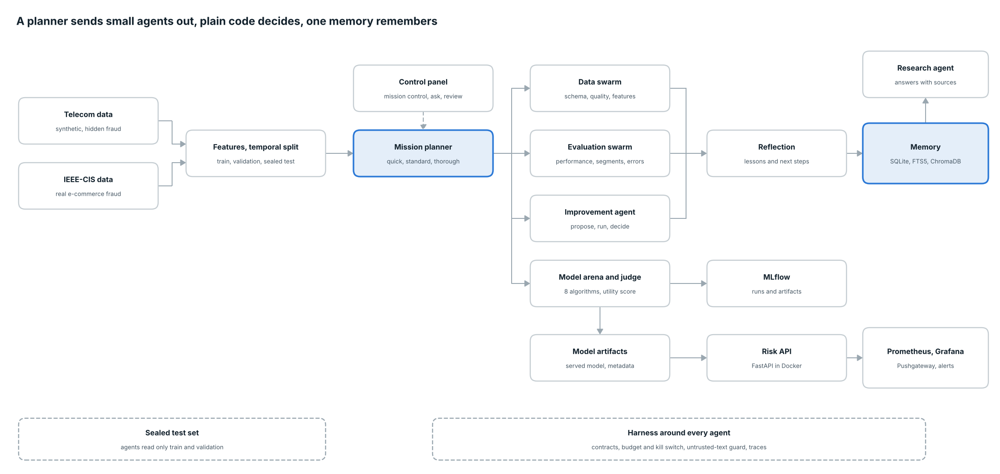
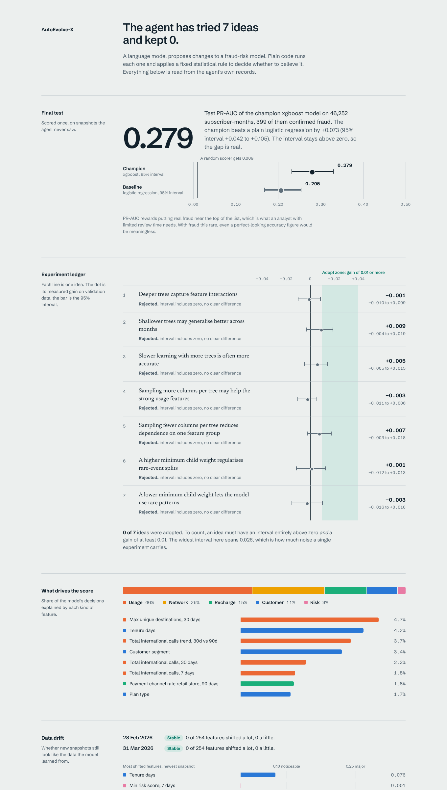

# AutoEvolve-X

[](https://github.com/Asm2910/autoevolve-x/actions/workflows/ci.yml)

A telecom fraud-risk system in which **a language model proposes improvements and plain code decides whether to believe them**. It is reproducible, honestly evaluated, served through an API and monitored with Prometheus and Grafana.

> The test set is sealed. The agent never sees it, and the final model is scored on it exactly once.

> **Work in progress (v3).** The numbers below are from dataset v1 (seed 42). From phase 10 the project uses dataset v2 (seed 20261018, a fresh sealed test) and an 8-algorithm model arena. The results sections are refreshed in the final phase. See [docs/PROGRESS.md](docs/PROGRESS.md).

## Headline result

On the sealed test snapshots the champion model reaches **PR-AUC 0.272** (95% CI 0.225 to 0.324). Logistic regression reaches 0.211, and the paired difference is **+0.061** (95% CI +0.030 to +0.094), so the gap is real. Only about 0.9% of rows are fraud, so a random scorer would reach about 0.009.

The agent ran 10 or more experiments and **adopted none**: every difference it found sat inside noise. That is a valid outcome. The lift over the baseline comes from the original model choice, not from the agent. See [Known limitations](#known-limitations).



## What it does

- **Synthetic data with a hidden ground truth.** The fraud state of each subscriber is decided first, and events are generated from it, so labels are not a function of the features. It includes legitimate look-alikes (heavy callers, travellers, night workers), label noise, delayed confirmation and drifting fraud types.
- **Leak-free features.** Nine monthly snapshots. Features use only events before the snapshot date, over 7, 30 and 90-day windows, plus trend features. 254 features in five groups: customer, usage, recharge, network, risk.
- **Temporal evaluation.** The first 5 snapshots train, the next 2 choose thresholds and drive the agent, and the last 2 are scored once. Scores carry bootstrap 95% confidence intervals, and model comparisons are paired.
- **A self-improving agent.** A LangGraph loop recalls past lessons, proposes one experiment (Claude, or a rule-based fallback), checks it is new, runs it, and adopts it only if its confidence interval lower bound is above zero and the gain is at least 0.01.
- **Memory.** SQLite is the source of truth, with FTS5 keyword search and a ChromaDB vector index, merged by reciprocal rank fusion.
- **Drift monitoring.** Label-free PSI and KS checks on features, with a simulator to rehearse drift.
- **Serving and monitoring.** A FastAPI service with request IDs, JSON logs and explanations, scraped by Prometheus and shown in a provisioned Grafana dashboard, with five alert rules.
- **Review dashboard.** A Streamlit page that shows the experiment ledger, the final test, feature importance and drift.
- **CI.** GitHub Actions runs ruff, pytest and a Docker build with a health check.

## Quick start

Needs Python 3.12 and, for the live stack, Docker.

```bash
python -m venv .venv && source .venv/bin/activate
pip install -r requirements-dev.txt

# 1. build the data and train the models (takes a few minutes)
python -m scripts.run_pipeline          # generate, validate, features, split, train

# 2. check everything
python -m ruff check .
python -m pytest -q

# 3. compare 8 algorithms on the validation snapshots, explain and ablate (optional)
python -m scripts.run_arena             # logistic regression, forests, 4 boosters, isolation forest
python -m scripts.run_arena --workers 4   # same comparison, four models at a time on Ray (pip install ray)
python -m scripts.benchmark_ray           # speed-up of 1, 2 and 4 workers
python -m scripts.run_ablation
python -m scripts.explain_model

# 4. fill the memory and run the agent
python -m scripts.memory_cli ingest
python -m scripts.run_mission --depth quick                 # plan, review, evaluate, improve, reflect in one graph
python -m scripts.run_data_review                           # four data agents check the sources and features
python -m scripts.run_evaluation                            # four evaluation agents report on the model
python -m scripts.run_agent --iterations 4                  # rule-based, no API key needed
python -m scripts.run_agent --iterations 4 --use-findings   # the proposer also reads the evaluation findings
python -m scripts.run_agent --iterations 4 --proposer llm   # Claude proposes, needs ANTHROPIC_API_KEY
touch memory/STOP                                           # from another terminal: stop a running agent

# 4b. the same system on real fraud data (IEEE-CIS from Kaggle)
python -m scripts.prepare_ieee --source ~/Downloads/ieee-fraud-detection.zip
AUTOEVOLVE_DATASET=ieee python -m scripts.run_arena --workers 1
AUTOEVOLVE_DATASET=ieee python -m scripts.run_evaluation

# 5. the evidence
python -m scripts.confirm_champion       # sealed test, runs once per dataset
python -m scripts.monitor_drift
python -m scripts.monitor_drift --simulate usage:1.6

# 6. look at it
python -m streamlit run dashboard/app.py
```

The live service, with Prometheus and Grafana:

```bash
docker compose up -d --build
python -m scripts.generate_traffic --count 300 --rate 10
python -m scripts.generate_traffic --count 300 --rate 10 --shift usage:1.6   # rehearse drift
```

| Service | Address |
| --- | --- |
| API and interactive docs | http://localhost:8000 and http://localhost:8000/docs |
| Prometheus (targets, alerts) | http://localhost:9090 |
| Grafana (provisioned dashboard) | http://localhost:3000 |

Use `python -m streamlit`, not a bare `streamlit`, so the virtual environment is used. Trained models must exist in `models/artifacts/` before the Docker build.

## Dashboard



*Example output from a local run. Your numbers will differ slightly, because each run generates its own data.*

<!-- Add a Grafana screenshot here once your stack is running:
 -->

## Repository layout

```
configs/               data and model settings
data_generation/       hidden world, behaviour profiles, event generators, snapshots, validation
feature_engineering/   windowed feature builder and its validation
models/                training, evaluation, explanations, MLflow tracking, artifacts
agents/                LangGraph agent, proposers, decision rule, experiment spec
memory/                SQLite store, ChromaDB index, embedders
tools/                 experiment runner, final evaluation
monitoring/            drift checks (PSI, KS)
observability/         JSON logging, Prometheus metrics and alerts, Grafana provisioning
dashboard/             Streamlit review page
api/                   FastAPI service
scripts/               runnable steps: pipeline, agent, drift, traffic, memory CLI
tests/                 unit and API tests
docs/                  overview, design, technical, data dictionary, end-to-end guide
.github/workflows/     CI
```

Generated data (`data/`) and the trained model (`models/artifacts/`) are git-ignored and recreated by `python -m scripts.run_pipeline`. CI runs the pipeline itself and hands the trained model to the Docker job. Each training run writes `model_metadata.json` (dataset hash, git commit, metrics, thresholds) and `model_report.md`.

## Documentation

| Document | What it is |
| --- | --- |
| [Overview](docs/01-overview.md) | One page: the idea, the result and the limits |
| [Design document](docs/02-design-document.md) | Why it is built this way, with trade-offs and risks |
| [Technical document](docs/03-technical-document.md) | Modules, metrics, alerts, commands, model card and runbook |
| [Data dictionary](docs/04-data-dictionary.md) | Every feature group and column name pattern |
| [End-to-end guide](docs/05-end-to-end-guide.md) | The whole project from data to monitoring, in order |
| [Security notes](SECURITY.md) | The API key, Grafana password and what to check |
| [Pending items](docs/PENDING.md) | What is still open |

## Configuration

Everything is seeded, and configuration lives in two files. `configs/data.yaml` sets the data world (25,000 customers, a 10% fraud rate, nine monthly snapshots). `configs/models.yaml` sets the features, model hyperparameters, thresholds and agent settings (`max_iterations`, `min_gain`, `bootstrap_samples`, `llm_model`).

The API key for the language-model proposer comes from the environment. Copy `.env.example` to `.env` and fill it in, or export `ANTHROPIC_API_KEY`. See [SECURITY.md](SECURITY.md).

## Known limitations

- **The data is synthetic.** Absolute scores say nothing about real telecom fraud. The point is the method.
- **The agent adopted nothing.** Its experiments all fell inside noise, so the champion is the original model. The value of the agent is that it can say so with evidence.
- **Probabilities are not calibrated.** Use scores for ranking and the validation-chosen threshold.
- **Drift detection only recommends.** A drift verdict suggests re-running the agent on fresh data. There is no ingestion step, so nothing retrains by itself.
- **No alert delivery.** Alerts show in Prometheus and Grafana, but no Alertmanager sends notifications.
- **The API has no authentication.** Put it behind a gateway before real use.

## Roadmap

1. Run the pipeline on a real public fraud dataset.
2. Add probability calibration.
3. Correct for multiple comparisons across agent experiments.
4. Add Alertmanager.
5. Add data ingestion so drift can trigger a retrain.

## License

MIT. See [LICENSE](LICENSE).

**Ask the project:** `python -m scripts.ask "your question" [--llm]` answers from the docs, reports and memory with sources (see docs/PROGRESS.md, Phase 17).
