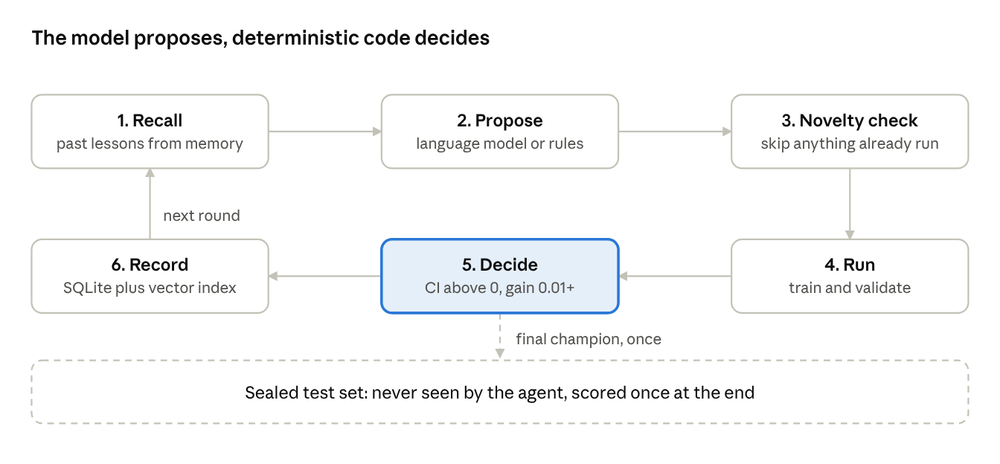

# AutoEvolve-X: One-Page Overview

2026-10-17

AutoEvolve-X is a fraud-risk scoring system that tries to improve itself under strict rules, then serves and monitors the result. A language model proposes experiments, and deterministic Python runs them, measures them and decides whether to adopt them. The held-out test set is sealed: the agent never sees it, and the final model is scored on it exactly once.

## The problem

Telecom subscribers who commit fraud are rare (about 0.9% of rows), so accuracy is meaningless and models are easy to fool. Letting an AI agent tune the model invites a worse failure: the agent quietly overfits to the data it is judged on. AutoEvolve-X is built so that cannot happen unnoticed.

## How it works

Each round recalls past lessons, proposes one experiment, runs it and records the result. The highlighted step is plain Python: an idea is adopted only when its bootstrap confidence interval lower bound is above zero and the mean gain is at least 0.01.

## Results

On the sealed test set the champion model beats logistic regression by 0.061 PR-AUC, and the paired confidence interval excludes zero. PR-AUC is the headline metric because only about 0.9% of rows are fraud.

| Model | PR-AUC on test | 95% CI |
| --- | --- | --- |
| Champion | 0.272 | 0.225 to 0.324 |
| Logistic regression | 0.211 | not reported |
| Paired difference | +0.061 | +0.030 to +0.094 |

The score is about 30 times the base rate. The agent ran 10 or more experiments and adopted none, so every difference it found sat inside noise.

## What it does not claim

- The data is synthetic, so the 0.272 says the pipeline works, not how it would do on real fraud.
- The agent adopted nothing. The lift over logistic regression comes from the original model choice, not from the agent.
- Drift detection recommends re-running the agent. It does not ingest new data, because the synthetic pipeline has no ingestion step.
- Probabilities are not calibrated, so read scores as rankings rather than true fraud rates.

## Stack and what ships

Everything runs from one repository, `Asm2910/autoevolve-x`, and 101 automated tests pass.

| Layer | Tools |
| --- | --- |
| Modeling | XGBoost, scikit-learn, bootstrap confidence intervals |
| Agent | LangGraph, Claude through `langchain-anthropic`, rule-based fallback |
| Memory | SQLite with FTS5, ChromaDB, reciprocal rank fusion |
| Tracking | MLflow on SQLite |
| Serving | FastAPI in a non-root Docker image |
| Monitoring | Prometheus, Grafana, five alert rules, PSI and KS drift checks |
| Review | Streamlit dashboard with an experiment ledger |
| Delivery | GitHub Actions: ruff, pytest, Docker build and health check |
