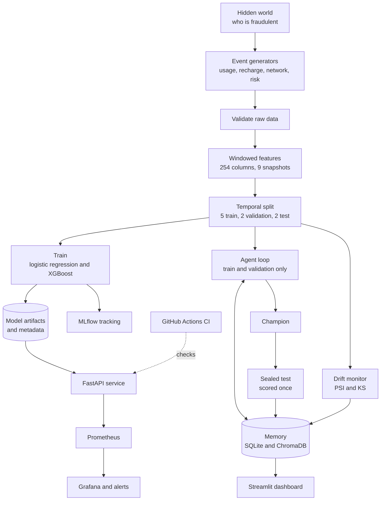

# AutoEvolve-X from end to end

This guide tells the whole story of the project in the order the work happens: from a synthetic world to a monitored service. Read the [overview](01-overview.md) for the short version and the [technical document](03-technical-document.md) for the reference.

## The idea in one paragraph

Fraud is rare, so it is easy to build a model that looks good and is not. It is even easier to fool yourself when an AI agent is allowed to tune the model, because the agent will happily improve whatever number it is shown. AutoEvolve-X is built around one rule: **the language model proposes, and deterministic code decides**. Every idea is measured with a confidence interval, the test set is sealed until the very end, and every decision is written to a memory the agent and the reviewer can both read.

## The whole pipeline



## Step 1: a world where the answer is known

Real fraud data is private and its labels are unreliable, so the project builds its own. The generator (`data_generation/`) decides first which subscribers are fraudulent, then generates their behaviour from that decision. This is the reverse of most toy datasets, where the label is computed from the features and a model finds it trivially.

The world includes the things that make fraud hard:

- legitimate look-alikes: heavy callers, travellers, night workers
- four fraud types (SIM box, subscription fraud, account takeover, wangiri) whose mix shifts over time
- delayed confirmation (a median of 14 days) and fraud that is never confirmed (15%)
- a little label noise: innocent subscribers wrongly confirmed (0.4%)

It produces 25,000 customers and about 2.1 million events over twelve months. A validation step (`scripts.validate_data`) checks the raw tables before anything else uses them.

## Step 2: features that cannot see the future

Scoring means: on a snapshot date, rate every active subscriber on whether fraud will be confirmed in the next 30 days. There are nine month-end snapshots.

For each subscriber and snapshot, `feature_engineering/` summarises their activity over the last 7, 30 and 90 days: counts, averages, shares and trends. That gives 254 features in five groups (customer, usage, recharge, network, risk), listed in the [data dictionary](04-data-dictionary.md). Subscribers whose fraud was already confirmed are dropped from that snapshot, because their status is known.

## Step 3: a split by time

The first five snapshots train the models. The next two choose decision thresholds and judge every agent experiment. The last two are **sealed**. Splitting by time matters because behaviour and fraud types change; a random split would let the model learn from the future.

Only about 0.9% of rows are fraud, so accuracy is useless and the headline metric is **PR-AUC**: how well real fraud is pushed to the top of the list, which is what an analyst with limited review time needs. The tables also report precision and recall within the top 1% of scores.

## Step 4: two models and honest numbers

`scripts.train_models` fits a logistic regression (the baseline) and an XGBoost model. The one with the best validation PR-AUC becomes the served champion. Every score carries a bootstrap 95% confidence interval, and when two models are compared the bootstrap resamples the same rows for both, so the difference is judged fairly.

Two more scripts add understanding. `scripts.explain_model` shows which features drive the score (usage and network features carry most of it). `scripts.run_ablation` drops or isolates each feature group to see which groups matter. Both log to MLflow, where every training run is also recorded.

## Step 5: a memory the agent can learn from

Each experiment and each lesson is written to SQLite, which is the source of truth. A ChromaDB index sits on top for meaning-based search, and keyword and vector results are merged by reciprocal rank fusion. Writing the same experiment twice changes nothing, so reruns are safe. `scripts.memory_cli` lets you ingest, search and read the memory by hand.

## Step 6: the agent


Each round the agent recalls relevant lessons, proposes one change to the model, checks the idea is new, runs it on the training and validation snapshots, decides, and records the result. A change is adopted only if its confidence interval lower bound is above zero **and** the gain is at least 0.01 PR-AUC.

Two safeguards surround the one language-model call. If the call fails, a rule-based proposer takes over. The model's reply must also fit a fixed schema, so it cannot slip in settings the code does not understand. The agent never reads the test snapshots.

## Step 7: what the agent found

Across 10 or more experiments (deeper and shallower trees, slower learning, different column sampling, different minimum child weight), **it adopted none**. Every gain was small and its interval included zero. In the live run the model chose to stop early, writing that results had plateaued at this data size.

That is a legitimate outcome and the most important result of the project. A loop that cannot say "none of these ideas are real" would have adopted luck. The widest interval spanned about 0.026 PR-AUC, which is how much noise a single experiment carries here.

## Step 8: the one sealed test

`scripts.confirm_champion` looks at the test snapshots once. It refuses to run a second time for the same dataset, because a second look would turn the test set into one more thing tuned on.

| Test result | PR-AUC | 95% CI |
| --- | --- | --- |
| Champion | 0.272 | 0.225 to 0.324 |
| Logistic regression | 0.211 | not reported |
| Paired difference | +0.061 | +0.030 to +0.094 |

The interval for the difference stays above zero, so the champion beats the baseline. Note where that credit belongs: the champion is the original model, not something the agent produced.

## Step 9: watching for drift

`scripts.monitor_drift` compares newer snapshots with the training data feature by feature, using the population stability index and a KS test. It needs no labels, because fraud labels arrive weeks late. A real check on the data was stable. A simulated check, with the usage features scaled by 1.6, was flagged as drift: 36 features moved a lot and 17 a little.

A drift verdict only **recommends** re-running the agent on fresh data. There is no ingestion step in the synthetic pipeline, so nothing retrains by itself. Simulated checks are never written to memory, so rehearsals cannot teach the agent false lessons.

## Step 10: a service

The champion is served by a FastAPI app in a non-root Docker image. `/predict` returns the risk probability, the decision at the validated threshold, the model version, a request ID and the top features behind the score. `/health`, `/model/info` and `/metrics` cover status, model details and monitoring.

## Step 11: watching the service


Prometheus scrapes the API every five seconds. Grafana shows nine panels: traffic, speed, errors, the share flagged as risky, and the distribution of risk scores over time. The score histogram doubles as a live drift signal that needs no labels. Five alert rules cover the API being down, high error rate, slow predictions, a shift in the score distribution and a burst of rejected requests. `scripts.generate_traffic` sends real validation rows to the API, with an option to shift one feature group, so you can watch drift appear.

## Step 12: a review page

The Streamlit dashboard reads only the memory. It shows the final test, the experiment ledger (one line per idea, with its interval against the adopt zone), what drives the score and the drift history. It is meant for a reviewer who wants to check the agent's work without reading logs.

## Step 13: keeping it honest

Each change was built on its own branch and merged with a merge commit, so `main` records the project in order. GitHub Actions lints the code with ruff, runs the tests (101 at the last run), builds the Docker image, starts it and waits for the health check. The monitoring files are tested too: every metric used in the dashboard or an alert must exist in the API.

## What the project shows, and what it does not

It shows a method: bound what an AI agent is allowed to decide, measure everything with uncertainty, seal the test set, and record every decision. The method held up: the agent found nothing and said so.

It does not show real-world fraud accuracy, because the data is synthetic. It does not show an agent that improves a model, because this one did not. Probabilities are uncalibrated. Drift is detected but not acted on. Alerts have no delivery channel. The API has no authentication. The [design document](02-design-document.md) lists these as risks, and the roadmap in the [README](../README.md) starts with a real public dataset.

## Reproduce it

```bash
python -m venv .venv && source .venv/bin/activate
pip install -r requirements-dev.txt
python -m scripts.run_pipeline
python -m scripts.run_ablation
python -m scripts.explain_model
python -m scripts.memory_cli ingest
python -m scripts.run_agent --iterations 4
python -m scripts.confirm_champion
python -m scripts.monitor_drift
python -m streamlit run dashboard/app.py
docker compose up -d --build
```

Each run generates its own data from a fixed seed, but results can differ slightly between machines, so expect your numbers to land close to those above rather than on them.
