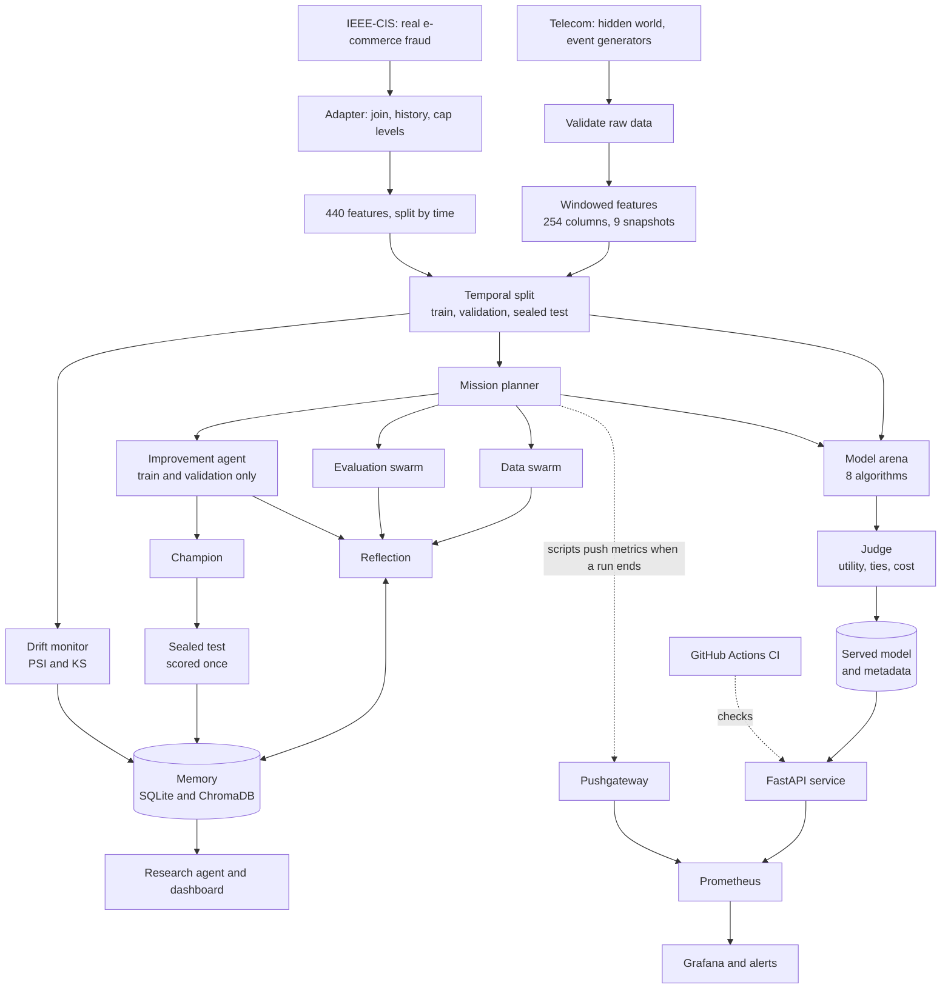
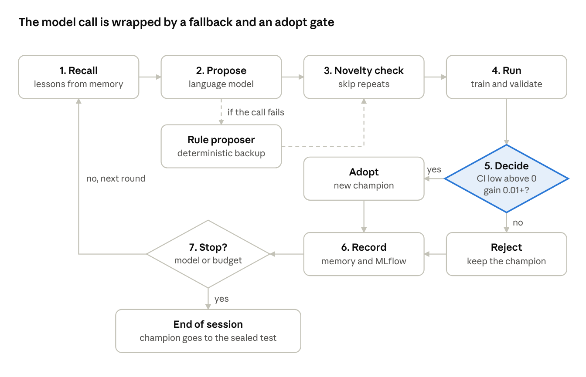
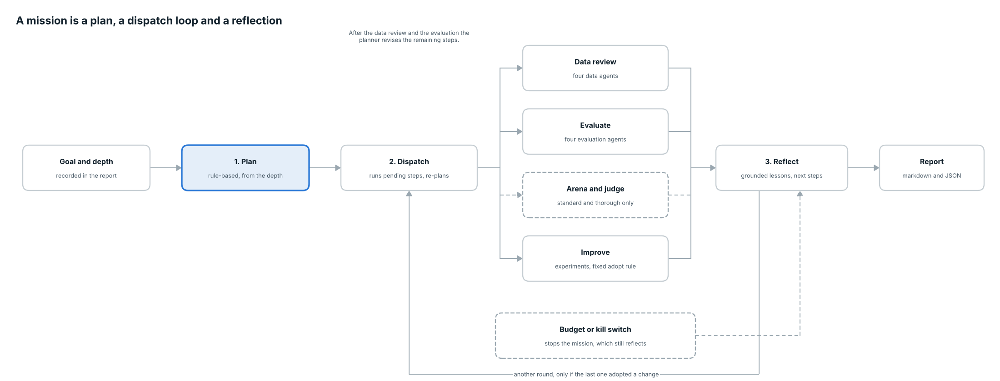
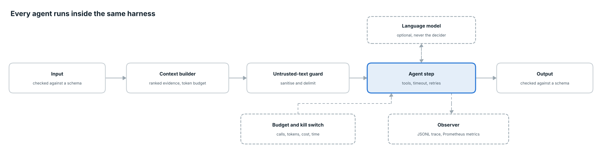
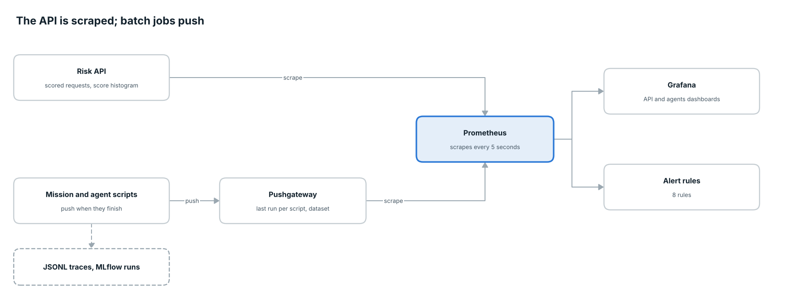

# AutoEvolve-X from end to end

This guide tells the whole story of the project in the order the work happens: from a synthetic world to a monitored service, and from one agent loop to a mission run by a planner. Read the [overview](01-overview.md) for the short version, the [architecture](ARCHITECTURE.md) for the diagrams and the [technical document](03-technical-document.md) for the reference.

## The idea in one paragraph

Fraud is rare, so it is easy to build a model that looks good and is not. It is even easier to fool yourself when an AI agent is allowed to tune the model, because the agent will happily improve whatever number it is shown. AutoEvolve-X is built around one rule: **the language model proposes, and deterministic code decides**. Every idea is measured with a confidence interval, the test set is sealed until the very end, every agent runs under a budget and a kill switch, and every decision is written to a memory the agents and the reviewer can both read.

## The whole pipeline



## Step 1: a world where the answer is known

Real fraud data is private and its labels are unreliable, so the project builds its own. The generator (`data_generation/`) decides first which subscribers are fraudulent, then generates their behaviour from that decision. This is the reverse of most toy datasets, where the label is computed from the features and a model finds it trivially.

The world includes the things that make fraud hard:

- legitimate look-alikes: heavy callers, travellers, night workers
- four fraud types (SIM box, subscription fraud, account takeover, wangiri) whose mix shifts over time
- delayed confirmation (a median of 14 days) and fraud that is never confirmed (15%)
- a little label noise: innocent subscribers wrongly confirmed (0.4%)

It produces 25,000 customers and about 2.1 million events over twelve months. A validation step (`scripts.validate_data`) checks the raw tables before anything else uses them.


## Step 2: features that cannot see the future

Scoring means: on a snapshot date, rate every active subscriber on whether fraud will be confirmed in the next 30 days. There are nine month-end snapshots.

For each subscriber and snapshot, `feature_engineering/` summarises their activity over the last 7, 30 and 90 days: counts, averages, shares and trends. That gives 254 features in five groups (customer, usage, recharge, network, risk), listed in the [data dictionary](04-data-dictionary.md). Subscribers whose fraud was already confirmed are dropped from that snapshot, because their status is known.


## Step 3: a split by time

On the telecom data the first five snapshots train the models. The next two choose decision thresholds and judge every agent experiment. The last two are **sealed**. Splitting by time matters because behaviour and fraud types change; a random split would let the model learn from the future.

Only about 0.9% of rows are fraud, so accuracy is useless and the headline metric is **PR-AUC**: how well real fraud is pushed to the top of the list, which is what an analyst with limited review time needs. The tables also report precision and recall within the top 1% of scores.


IEEE-CIS has no snapshots. It is split by time instead: the earliest 60% of payments train, the next 20% tune, and the last 20% are sealed.

## Step 4: eight models, one judge

`scripts.run_arena` trains eight algorithms on the same data (logistic regression, random forest, extra trees, XGBoost, LightGBM, histogram gradient boosting, CatBoost and an isolation forest) and ranks them on the validation snapshots. Every score carries a bootstrap 95% confidence interval, and when two models are compared the bootstrap resamples the same rows for both, so the difference is judged fairly. Models whose interval overlaps the leader are reported as tied, not ranked below it.

`scripts.train_models` then lets the **judge** pick the served model. Each model gets a business utility per 10,000 accounts (400 for each fraud caught, minus 6 for each reviewed account, minus 3 for each false alarm). Models that cannot explain a score are excluded, because the API returns reasons. Among models tied within noise the judge serves the cheapest to run. On telecom three boosted models were tied and XGBoost was served: it trains in about two seconds and is 0.4 MB. On IEEE-CIS the judge served LightGBM.

The arena can run on Ray (`--workers 4`). Ray did not help here: seven small models took 104.6 s sequentially, 112.2 s on two workers and 132.7 s on four. It is kept for isolation, timeouts, retries and a path to a cluster.

Two more scripts add understanding. `scripts.explain_model` shows which features drive the score. `scripts.run_ablation` drops or isolates each feature group to see which groups matter. Both log to MLflow, where every training run is also recorded.

## Step 5: a memory the agents can learn from

Each experiment and each lesson is written to SQLite, which is the source of truth. A ChromaDB index sits on top for meaning-based search, and keyword and vector results are merged by reciprocal rank fusion. Writing the same experiment twice changes nothing, so reruns are safe. Each dataset has its own memory. `scripts.memory_cli` lets you ingest, search and read the memory by hand.

## Step 6: the improvement agent



Each round the agent recalls relevant lessons and any findings from the swarms, proposes one change to the model, checks the idea is new, runs it on the training and validation data, decides, and records the result. A change is adopted only if its confidence interval lower bound is above zero **and** the gain is at least 0.01 PR-AUC.

Two safeguards surround the one language-model call. If the call fails, a rule-based proposer takes over. The model's reply must also fit a fixed schema, so it cannot slip in settings the code does not understand. The agent never reads the test data.

## Step 7: the data swarm

Before any model is trusted, four agents look at the data (`scripts.run_data_review`). The schema agent checks columns, types and categories. The quality agent looks for missing values, duplicate ids, constant columns, impossible values and odd timestamps. The relationship agent checks that the sources join cleanly and that history is built from before each snapshot. The feature agent asks which feature groups carry signal after correcting for the many tests it runs (Benjamini-Hochberg false discovery control, plus an effect-size floor, because with 100,000 rows almost everything is significant). It also flags any feature that predicts almost perfectly as a possible leak. Findings are ranked by severity and handed on to the planner and the improvement agent.

## Step 8: the evaluation swarm

Four more agents look at the current model (`scripts.run_evaluation`). The performance agent reports how good it is and whether it is steady. The segment agent looks for customer groups where it does worse, correcting for the number of groups tested, and merges groups that cover identical accounts so the report is not 100 near-duplicates. The error agent compares the frauds it misses with the ones it catches. The drift agent checks that the data being scored still looks like the training data. On IEEE-CIS this found a real weakness: fraud among payments with no identity record was caught at about 6.5%, against 37.8% overall.

## Step 9: a mission

`scripts.run_mission` ties it together. A planner chooses the steps from a depth: quick (data review, evaluate, improve, reflect), standard or thorough (adding the model arena, more experiments and more rounds). A dispatch loop runs the pending steps, and the plan is revised after the data review and the evaluation. A failed step is recorded and skipped. **Reflection** then writes lessons grounded in what was actually found, and runs another improvement round only if the last one adopted a change.



The planner does not read the goal text: the goal is recorded in the report, and the depth decides the steps. This is a limit, and the report says so.

## Step 10: bounds on every agent

Every agent runs inside the same harness.



Each has a contract (schemas, allowed tools, a timeout and retries). A budget caps language-model calls, tokens, cost, time and experiments, and a kill switch file (`touch memory/STOP`) stops a run at its next step. Text that came from outside the code (data, reports, retrieved passages, a question) is sanitised and delimited as untrusted before it reaches a prompt. Every step is traced to a JSONL file and counted in Prometheus metrics. The injection filter is pattern-based, so it is one layer of defence. The stronger protection is structural: nothing a model returns can change a model or a score without passing a check written in code.

## Step 11: real data

The same system runs on a second, real dataset: IEEE-CIS e-commerce fraud from Kaggle (`scripts.prepare_ieee`). It is kept completely separate from the telecom data, with its own folders, config, models and memory, switched by `AUTOEVOLVE_DATASET=ieee`. It has 440 features in 11 groups, including per-card history built only from earlier payments. It is e-commerce fraud, not telecom, and it is used as validation on real data, not as a replacement for the telecom project.

## Step 12: asking the project

`scripts.ask` answers questions about the project from its own README, documents, reports and memory, with sources. Without a model it shows the closest passages. With `--llm` a model writes a short answer from numbered passages, and code checks it: every citation must name a passage that was shown, every number must appear in a cited passage, and an answer with no citation is withheld. If nothing matches, it says it could not find the answer.

## Step 13: what the agents found

On the telecom data (v2) the improvement agent tried window changes and adopted none. For example, dropping the 30-day window changed validation PR-AUC by -0.014 with an interval of -0.030 to +0.002, which includes zero. On IEEE-CIS it adopted deeper trees: +0.018 at depth 4 and +0.014 at depth 5, with intervals above zero.

Rejecting is a legitimate outcome and an important one. A loop that cannot say "none of these ideas are real" would have adopted luck. On the first version of the data the agent also ran 10 or more experiments and adopted none, and the widest interval spanned about 0.026 PR-AUC, which is how much noise a single experiment carries there.

## Step 14: the one sealed test

`scripts.confirm_champion` looks at the test data once. It refuses to run a second time for the same dataset, because a second look would turn the test set into one more thing tuned on.

| Test result (dataset v1) | PR-AUC | 95% CI |
| --- | --- | --- |
| Champion | 0.272 | 0.225 to 0.324 |
| Logistic regression | 0.211 | not reported |
| Paired difference | +0.061 | +0.030 to +0.094 |

**Dataset v2 (current, seed 20261018, fresh sealed test).** The model choice was made on validation only; the test table below reports every model once and was not used to choose. Telecom: 381 positives in 46,291 test rows. IEEE-CIS (real e-commerce fraud, a separate validation, not telecom data): 2,060 positives in 60,000 test rows.

| Dataset | Served model | Test PR-AUC [95% CI] | Logistic regression |
| --- | --- | --- | --- |
| Telecom v2 | xgboost | 0.292 [0.243, 0.356] | 0.213 [0.173, 0.265] |
| IEEE-CIS | lightgbm | 0.448 [0.425, 0.472] | 0.185 [0.173, 0.200] |

On telecom v2 the top boosted and bagged models are statistically tied (random forest 0.300, extra trees 0.300, xgboost 0.292), which is why the judge chose by cost to run rather than by the highest point estimate. The paired difference against logistic regression has not been recomputed for v2. On version 1 the interval for the difference stayed above zero, so the champion beat the baseline, and that credit belongs to the original model, not to the agent.

## Step 15: watching for drift

`scripts.monitor_drift` compares newer snapshots with the training data feature by feature, using the population stability index and a KS test. It needs no labels, because fraud labels arrive weeks late. A real check on the data was stable. A simulated check, with the usage features scaled by 1.6, was flagged as drift: 36 features moved a lot and 17 a little.

A drift verdict only **recommends** re-running the agent on fresh data. There is no ingestion step in the synthetic pipeline, so nothing retrains by itself. Simulated checks are never written to memory, so rehearsals cannot teach the agent false lessons.


## Step 16: a service

The served model (chosen by the judge) runs in a FastAPI app in a non-root Docker image. `/predict` returns the risk probability, the decision at the validated threshold, the model version, a request ID and the top features behind the score. `/health`, `/model/info` and `/metrics` cover status, model details and monitoring.

## Step 17: watching the service and the agents



Prometheus scrapes the API every five seconds. Grafana shows nine API panels: traffic, speed, errors, the share flagged as risky, and the distribution of risk scores over time. The score histogram doubles as a live drift signal that needs no labels. `scripts.generate_traffic` sends real validation rows to the API, with an option to shift one feature group, so you can watch drift appear.

Missions finish before Prometheus would scrape them, so the mission and review scripts push their final metrics to a Pushgateway (set `PUSHGATEWAY_URL`). A second Grafana dashboard shows what the agents did in their last runs: time since the last run, the champion score, language-model spend and tokens, experiments by verdict, failed steps, findings, step latency and calls. It shows the last run of each script, not a history. Eight alert rules cover the API being down, a high error rate, slow predictions, a shift in the score distribution, a burst of rejected requests, failed agent steps, high language-model spend and agents that have not reported for a week.

## Step 18: a control panel

The Streamlit dashboard has three parts. The review page reads the memory and shows the final test, the experiment ledger (one line per idea, with its interval against the adopt zone), what drives the score and the drift history. **Mission control** lets you describe a goal, pick the dataset and depth, preview the plan, start the mission, watch its log and stop it. It runs the mission as a separate process, so closing the tab does not stop it. The **ask page** is the research agent.

## Step 19: keeping it honest

Each change was built on its own branch and merged with a merge commit, so `main` records the project in order. GitHub Actions lints the code with ruff, runs the tests (291 at the last run), runs a quick mission and a research question on freshly built data, builds the Docker image, starts it and waits for the health check. The monitoring files are tested too: every metric used in a dashboard or an alert must exist, and a real push to a stand-in gateway is part of the tests. Agent tests never need an API key, because model paths run against scripted doubles.

## What the project shows, and what it does not

It shows a method: bound what an AI agent is allowed to decide, measure everything with uncertainty, correct for the number of tests, seal the test set, choose models by cost and evidence, and record every decision. The method held up. The agents found nothing worth adopting on the telecom data and said so, and found a small, real improvement and a real weakness on the IEEE data.

It does not show real telecom fraud accuracy, because the telecom data is synthetic, and IEEE-CIS is one e-commerce dataset. The planner does not read the goal. The injection filter is pattern-based. Ray did not speed anything up here. Probabilities are uncalibrated, drift is detected but not acted on, alerts have no delivery channel, the API has no authentication, and the Docker stack was only partly tested. The [design document](02-design-document.md) lists these as risks, and [PENDING.md](PENDING.md) lists what is still open.

## Reproduce it

```bash
python -m venv .venv && source .venv/bin/activate
pip install -r requirements-dev.txt
python -m scripts.run_pipeline
python -m scripts.run_arena
python -m scripts.run_ablation
python -m scripts.explain_model
python -m scripts.memory_cli ingest
python -m scripts.run_data_review
python -m scripts.run_evaluation
python -m scripts.run_mission --depth standard
python -m scripts.ask "Why is xgboost the served model?"
python -m scripts.confirm_champion
python -m scripts.monitor_drift
python -m streamlit run dashboard/app.py
docker compose up -d --build

# real data
python -m scripts.prepare_ieee --source ~/Downloads/ieee-fraud-detection.zip
AUTOEVOLVE_DATASET=ieee python -m scripts.run_arena
AUTOEVOLVE_DATASET=ieee python -m scripts.run_mission --depth standard
```

Each run generates its own data from a fixed seed, but results can differ slightly between machines, so expect your numbers to land close to those above rather than on them.
