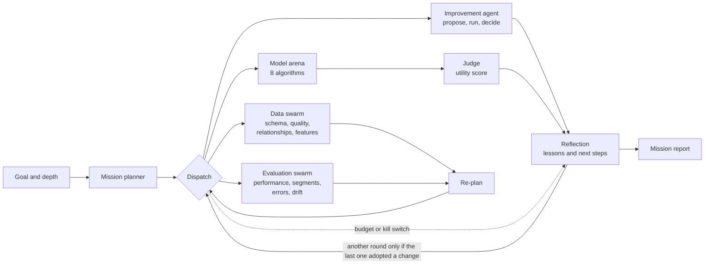
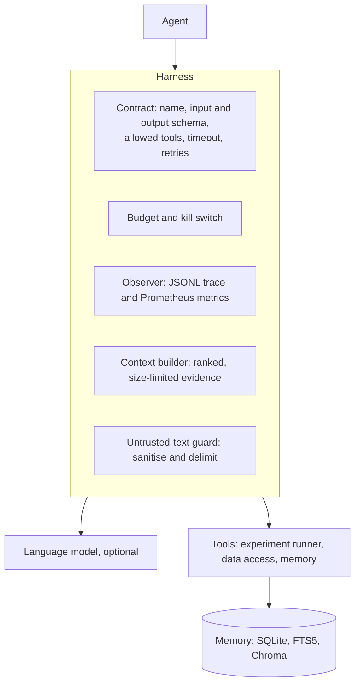
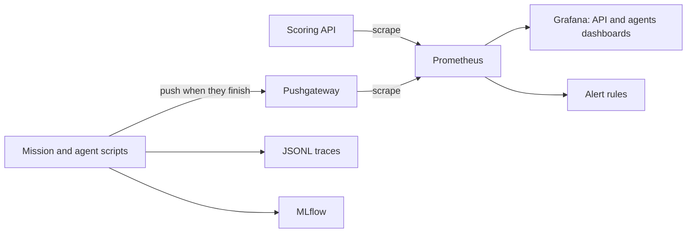

# Architecture (v2)

One rule runs through everything: **the language model proposes; deterministic Python validates, runs and decides.** Nothing a model writes changes a model, a threshold or a score without passing a check written in plain code.

## 1. A mission, end to end

A mission is a LangGraph graph. The planner makes a plan from the chosen depth, a dispatcher runs the pending steps, and the plan is revised after the data review and the evaluation. The planner is rule-based and does not read the goal text; the goal is recorded in the report.

A failed step is recorded and the mission carries on. The budget (calls, tokens, cost, time, experiments) and the kill switch (`touch memory/STOP`) stop a mission cleanly, and it still reflects before it ends.

## 2. Who decides what

| Question | Who answers | How |
| --- | --- | --- |
| Which experiment next? | Language model or rule-based proposer | Proposes one change, from a fixed set of allowed settings |
| Is the change real? | Plain code | Paired bootstrap on validation: interval lower bound above 0 and mean gain of at least 0.01 PR-AUC |
| Which model is served? | Judge (plain code) | Utility per 10,000 accounts, paired bootstrap, models that cannot explain are excluded, ties go to the cheapest to run |
| Is a feature worth keeping? | Data swarm (plain code) | Benjamini-Hochberg false discovery control plus an effect-size floor and a leakage check |
| Is the model weak somewhere? | Evaluation swarm (plain code) | Bonferroni-corrected bootstrap per segment |
| Is the test set still sealed? | Data access layer | Agents can load only train and validation; the test split is read once per dataset |
| Is an answer from the research agent grounded? | Plain code | Citations must exist, numbers must appear in the cited passages |

## 3. The agent platform

Every agent runs inside the same harness.

Text that comes from outside the code (data, reports, retrieved passages, the user's question) is sanitised and wrapped as untrusted data before it reaches a prompt. The filter is pattern-based, so it is a layer, not a guarantee.

## 4. Monitoring

The Pushgateway holds the last run of each script per dataset, so the agents dashboard shows the latest runs, not a history. History is in the traces and the experiment memory.

## 5. Where things live

| Folder | What it holds |
| --- | --- |
| `agentkit/` | Harness, budget, guardrails, tracing, context builder, language-model doubles for tests |
| `agents/` | The improvement loop, proposers, the decision rule |
| `swarm/` | Data swarm and evaluation swarm |
| `arena/`, `judge/` | Eight algorithms behind one registry, executors (sequential or Ray), the utility judge |
| `mission/` | Planner, mission graph, reflection, report |
| `research/` | Local retrieval and the grounded research agent |
| `data_adapters/` | IEEE-CIS adapter (real e-commerce fraud, separate from the telecom data) |
| `dashboard/` | Review page, mission control, ask page |
| `observability/` | Metrics, push, alerts, Grafana provisioning |
